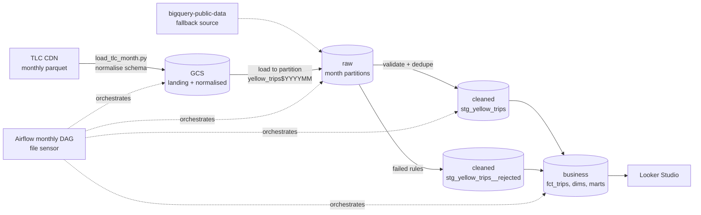

# NYC Taxi Operations Warehouse on BigQuery (large volume)

**Live app (filters + live BigQuery queries):** https://bigquery-warehouse-explorer.streamlit.app

A production-style BigQuery warehouse over the NYC TLC yellow-taxi trip records: roughly
**3–4 million trips per month, ~40 million per year** loaded, validated and modelled through
**raw → cleaned → business** layers with dbt, orchestrated monthly by Airflow (Cloud Composer).

The focus is what changes at volume: schema drift between source files, idempotent reloads,
incremental processing that only touches changed partitions, partitioning and clustering for
cost, and a quarantine table so bad records are measured instead of silently dropped.

## Business questions (scenario)

| Stakeholder | Question | Mart |
|---|---|---|
| Finance | Daily gross revenue, fares vs tips vs surcharges, congestion fees collected | `mart_daily_revenue` |
| Fleet ops | Where and when is demand highest, and which zone-hours earn the most per occupied hour? | `mart_zone_hourly_demand` |
| Airport ops | JFK / LGA / EWR volume, direction, durations, flat-fare usage | `mart_airport_trips` |
| Product / pricing | How tipping varies by borough, time of day and trip length | `mart_tipping_behavior` |
| Data platform | How many rows arrived, were accepted, rejected (by rule) or de-duplicated each month | `mart_data_quality_monthly` |

Ad-hoc analyses in `dbt/analyses/`: congestion pricing before/after (Jan 2025) and a
partition-pruning cost demo.

## Architecture



| Layer | Contents | Physical design |
|---|---|---|
| `raw.yellow_trips` | Every source row, normalised to one schema, plus `source_month`, `_source_file`, `_ingested_at` | Partitioned by `source_month` (MONTH), clustered by pickup zone |
| `cleaned.stg_yellow_trips` | Valid, de-duplicated trips with surrogate `trip_id` and soft DQ flags | Incremental, partitioned by `pickup_date` (DAY), clustered by pickup/drop-off zone |
| `cleaned.stg_yellow_trips__rejected` | Trips that broke a hard rule, with `reject_reason` | Incremental, partitioned by month, clustered by reason |
| `business.fct_trips` | Trip fact enriched with zones, airports, time bands, rate/payment/vendor names, speed, tip % | Incremental, partitioned by `pickup_date`, clustered by zones + payment type |
| `business.mart_*` | Aggregates for dashboards | Small tables; `mart_daily_revenue` is itself incremental |

## Engineering decisions worth discussing

**1. Schema drift is handled at ingestion.** TLC files differ by year (`airport_fee` vs
`Airport_fee`, passenger_count stored as INT or DOUBLE, `cbd_congestion_fee` new in 2025).
Each file is normalised with pyarrow to a canonical schema before loading; unknown new
columns are logged as warnings rather than breaking the load.

**2. Idempotent month loads.** Each file is written with `WRITE_TRUNCATE` to its own
partition (`raw.yellow_trips$202403`). Re-running a month replaces exactly that month; the
DAG can be retried or backfilled without creating duplicates.

**3. Incremental models reprocess only what changed, with real partition pruning.**
`changed_month_window()` asks BigQuery at compile time which months have a newer
`_ingested_at` than the target, then renders literal dates into the `WHERE` clause.
A subquery filter would not prune partitions and would scan the full history every run;
literal dates mean a monthly run reads one or two months. Models use
`insert_overwrite`, so a re-delivered month replaces its partitions atomically.

**4. Nothing is silently dropped.** Hard rules (missing timestamps, pickup outside the
file's month, non-positive or >6h duration, zero or >200 mi distance, >90 mph, negative
amounts, >$1,000) route rows to the quarantine table with the first rule broken. Soft issues
(missing passenger count, unknown zones 264/265, source duplicates) are kept as boolean flags.
`mart_data_quality_monthly` shows raw → accepted / rejected-by-rule / duplicates per month,
and a test fails the run if more than 10% of a month is rejected.

**5. No natural key.** TLC has no trip id. `trip_id` is a `FARM_FINGERPRINT` of the trip's
attributes; exact duplicates collapse to one row and are counted.

**6. Cost controls.** Partition + cluster keys match dashboard filters (date range, zone,
payment type); dashboards read marts, not the fact; dev targets have `maximum_bytes_billed`;
`monitoring/cost_and_usage.sql` reports storage per layer, bytes billed per user and
the most expensive queries against `fct_trips`. CI validates every model with `dbt build --empty`
(LIMIT 0) and builds one real month, so pull requests cost cents.

**7. Data quality gates between layers.** `dbt build` runs tests per layer, so the business
layer is not refreshed from a failing cleaned layer. Reconciliation test: trips and revenue per
month must match between cleaned and business.

## Run it

Prerequisites: GCP project (billing enabled, or BigQuery sandbox for small ranges), `gcloud`,
Python 3.10+, Terraform (optional).

```bash
export GCP_PROJECT=your-project-id
gcloud auth application-default login

make setup
make infra                                   # optional: bucket, datasets per layer, service account
make ingest START=2024-01 END=2024-06        # download from TLC -> GCS -> raw
#   or, no download needed:
make ingest-public START=2022-01 END=2022-06 # copy from bigquery-public-data
make build                                   # seeds + cleaned + business + tests
```

Load another month later and run `make build` again: only the new month is processed
(watch the "Incremental window" log line).

Volume check after loading:

```sql
select outcome, sum(rows) as rows
from `YOUR_PROJECT.business.mart_data_quality_monthly`
group by outcome order by rows desc;
```

## Repo layout

```
ingestion/load_tlc_month.py      download, normalise schema, land in GCS, load month partition
dbt/macros/validated_trips.sql   validation rules + dedupe (shared by valid and rejected models)
dbt/macros/incremental_window.sql compile-time changed-month window for partition pruning
dbt/models/cleaned/              stg_yellow_trips, stg_yellow_trips__rejected, stg_taxi_zones
dbt/models/business/             dim_zones, dim_date, fct_trips, 5 marts + exposure
dbt/seeds/                       payment type, rate code, vendor lookups (TLC data dictionary)
dbt/tests/                       layer reconciliation, reject-rate guard
dbt/analyses/                    congestion pricing impact, partition pruning demo
monitoring/cost_and_usage.sql    INFORMATION_SCHEMA cost and usage queries
orchestration/dags/              monthly Composer DAG with file-availability sensor
infra/terraform/                 bucket, raw/cleaned/business datasets, IAM
.github/workflows/ci.yml         lint, dbt build --empty, one-month build
```

Source data: [NYC TLC Trip Record Data](https://www.nyc.gov/site/tlc/about/tlc-trip-record-data.page).
